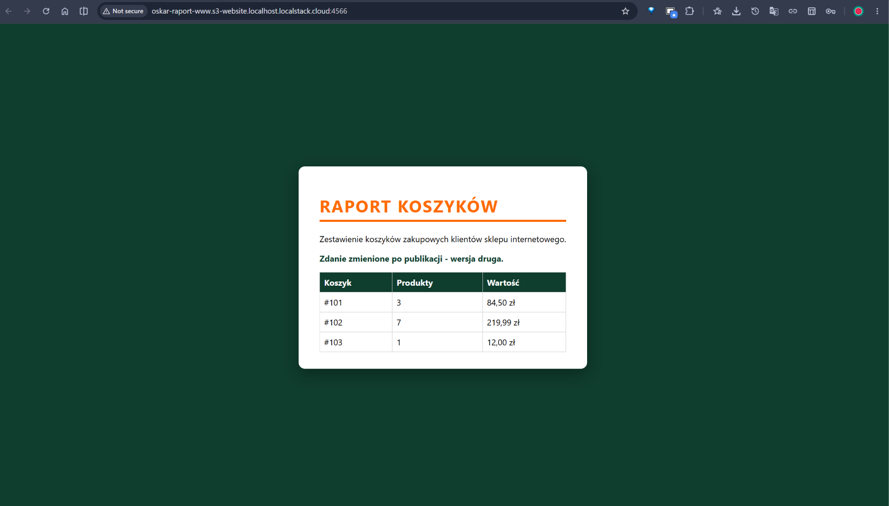
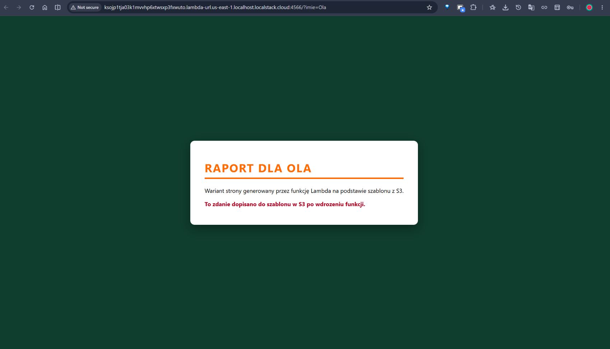
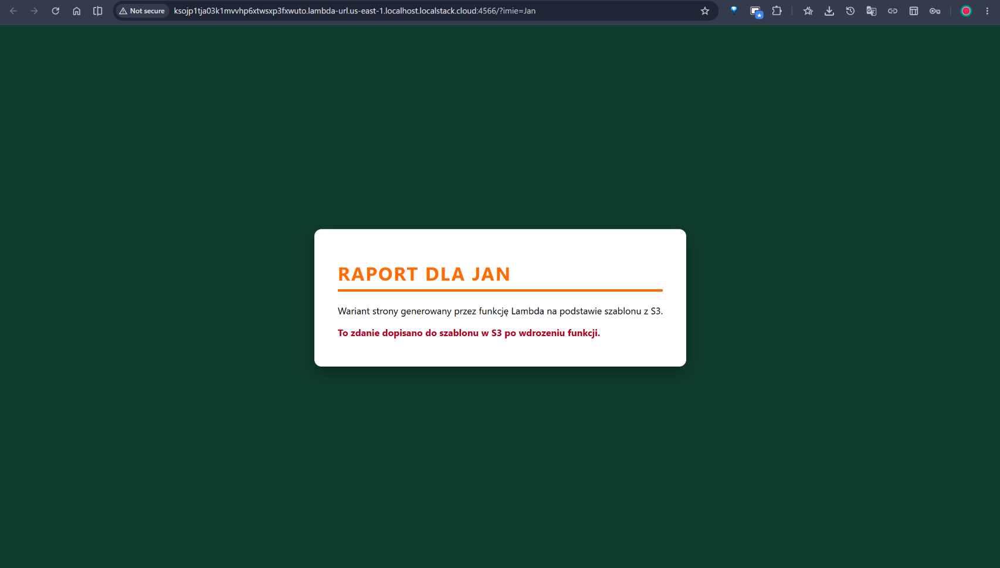

# Lab 2 – Jedna strona, dwa sposoby udostępnienia

**Autor:** Oskar Učkuronis, nr albumu 91633, grupa 2

## Zasoby

| Element | Nazwa |
|---|---|
| Bucket strony statycznej (S3 Website) | `oskar-raport-www` |
| Bucket szablonu (prywatny, domyślny dostęp) | `oskar-raport-szablony` |
| Obiekt szablonu | `s3://oskar-raport-szablony/template.html` |
| Funkcja Lambda | `oskar-raport-lambda` (Python 3.12) |
| Polityka bucketu | `s3/website-policy.json` |
| Adres S3 Website | `http://oskar-raport-www.s3-website.localhost.localstack.cloud:4566/` |
| Function URL | `http://ksojp1tja03k1mvvhp6xtwsxp3fxwuto.lambda-url.us-east-1.localhost.localstack.cloud:4566/` |

Pełna lista poleceń: `dowody/polecenia.sh`, wynik z terminala: `dowody/polecenia-wynik.txt`.

## 1. Środowisko

LocalStack uruchomiony przez Docker Compose (`compose.yaml`). Port 4566 wystawiony tylko na `127.0.0.1`. Do uruchamiania funkcji Lambda LocalStack potrzebuje dostępu do Dockera hosta, dlatego zamontowano `/var/run/docker.sock`. Token `LOCALSTACK_AUTH_TOKEN` jest w lokalnym `.env`, który jest w `.gitignore` (w repo tylko `.env.example`).

```bash
docker compose up -d
curl -s http://localhost:4566/_localstack/health
export AWS_ENDPOINT_URL=http://localhost:4566 AWS_ACCESS_KEY_ID=test AWS_SECRET_ACCESS_KEY=test AWS_DEFAULT_REGION=us-east-1
```

## 2. S3 Website

```bash
aws s3 mb s3://oskar-raport-www
aws s3api put-bucket-policy --bucket oskar-raport-www --policy file://s3/website-policy.json
aws s3 website s3://oskar-raport-www --index-document index.html
aws s3 cp www/index.html s3://oskar-raport-www/index.html --content-type "text/html; charset=utf-8"
aws s3 cp www/style.css  s3://oskar-raport-www/style.css  --content-type "text/css"
```

Po publikacji zmieniono zdanie „Wersja pierwsza strony opublikowana w S3.” na „Zdanie zmienione po publikacji - wersja druga.” i ponownie przesłano `index.html`.



## 3. Lambda Function URL

```bash
aws s3 mb s3://oskar-raport-szablony
aws s3 cp lambda/template.html s3://oskar-raport-szablony/template.html
(cd lambda && zip function.zip lambda_function.py)
aws lambda create-function --function-name oskar-raport-lambda --runtime python3.12 \
  --handler lambda_function.lambda_handler --zip-file fileb://lambda/function.zip \
  --role arn:aws:iam::000000000000:role/lambda-raport-role \
  --environment "Variables={TEMPLATE_BUCKET=oskar-raport-szablony,TEMPLATE_KEY=template.html}"
aws lambda create-function-url-config --function-name oskar-raport-lambda --auth-type NONE
```





Po wdrożeniu dopisano do szablonu zdanie „To zdanie dopisano do szablonu w S3 po wdrozeniu funkcji.” i podmieniono obiekt **`s3://oskar-raport-szablony/template.html`**. Funkcji nie wdrażano ponownie – po odświeżeniu strony zdanie jest widoczne.

## 4. Odpowiedzi HTTP i źródło HTML

**200 + Content-Type:**
```
PS> curl.exe -si "<Function URL>?imie=Ola"
HTTP/1.1 200 OK
Server: TwistedWeb/26.10.0
Date: Mon, 16 Nov 2026 22:25:52 GMT
Content-Type: text/html; charset=utf-8
Connection: keep-alive
x-amzn-requestid: e6e65ca6-efcf-4c36-9af3-e6bd621d724d
x-amzn-trace-id: 015e9ead-4976-4740-b4e8-38379010f436
Content-Length: 905
x-localstack: 2026.10.7

<!DOCTYPE html>
<html lang="pl">
<head>
  <meta charset="utf-8">
  <meta name="viewport" content="width=device-width, initial-scale=1">
  <title>Raport koszyków</title>
  <style>
    body { margin: 0; min-height: 100vh; background: #0f3d2e; font-family: system-ui, sans-serif;
           display: flex; align-items: center; justify-content: center; }
    .karta { background: #fff; border-radius: 12px; padding: 2rem 2.5rem;
             box-shadow: 0 10px 30px rgba(0,0,0,.35); max-width: 560px; }
    h1 { color: #ff6b00; text-transform: uppercase; letter-spacing: 2px;
         border-bottom: 4px solid #ff6b00; padding-bottom: .4rem; }
    .nowe { font-weight: bold; color: #b00020; }
  </style>
</head>
<body>
  <main class="karta">
    <h1>Raport dla Ola</h1>
    <p>Wariant strony generowany przez funkcję Lambda na podstawie szablonu z S3.</p>
    <!-- NOWE_ZDANIE -->
  </main>
</body>
</html>
```

**400 bez parametru:**
```
PS> curl.exe -si "<Function URL>"
HTTP/1.1 400 BAD REQUEST
Server: TwistedWeb/26.10.0
Date: Mon, 16 Nov 2026 22:25:55 GMT
Content-Type: text/html; charset=utf-8
Connection: keep-alive
x-amzn-requestid: f4494fcf-1c7c-4b62-9cfe-97dd5d01aa61
x-amzn-trace-id: 5ac9f803-433b-403f-b906-0d657eb952ef
Content-Length: 132
x-localstack: 2026.10.7

<!DOCTYPE html><meta charset='utf-8'><h1>400 – brak parametru imie</h1><p>Dodaj do adresu parametr, np. <code>?imie=Ola</code></p>
```

**Obiekt odczytany z S3 – nadal zawiera `{{IMIE}}`:**
```
PS> aws s3 cp s3://oskar-raport-szablony/template.html - | Select-String "{{IMIE}}"
<h1>Raport dla {{IMIE}}</h1>
```

## 5. Wniosek

- **Kto dostarcza HTML.** W wariancie S3 Website HTML dostarcza bezpośrednio S3 – zwraca gotowy plik dokładnie taki, jaki przesłano, bez żadnego przetwarzania. W wariancie Lambda HTML dostarcza funkcja: przy każdym żądaniu pobiera szablon z S3, wstawia (zabezpieczone `html.escape`) imię i zwraca wygenerowaną odpowiedź z kodem 200 lub 400.
- **Kiedy wystarczy strona statyczna.** Gdy treść jest jednakowa dla wszystkich odwiedzających i nie zależy od parametrów żądania – np. strona informacyjna, dokumentacja, raport generowany z góry. Jest wtedy tańsza, prostsza i szybsza (brak kodu do uruchomienia).
- **Po co szablon osobno od kodu.** Wygląd i treść strony można zmieniać przesyłając nowy obiekt do S3, bez ponownego budowania i wdrażania funkcji – co pokazano w punkcie 3. Rozdziela to odpowiedzialność (logika vs. prezentacja), paczka wdrożeniowa zawiera tylko kod, a sam szablon może pozostać w prywatnym buckecie, do którego dostęp ma tylko funkcja.
